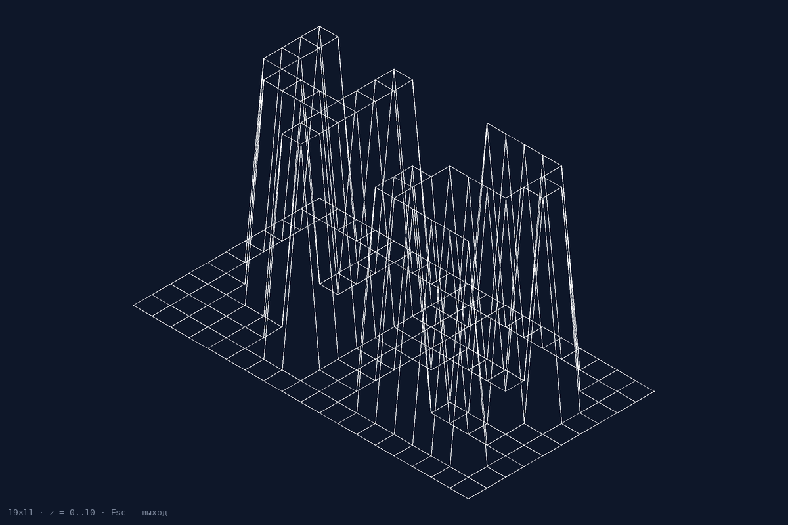

# FdF — каркасная 3D-модель карты высот

[](https://github.com/<логин>/fdf-python/actions/workflows/ci.yml)



## Описание

Программа читает файл карты высот `.fdf` и показывает каркасную (wireframe)
модель поверхности в изометрической проекции. Это реализация проекта FdF
(Fil de Fer) школы 42 на Python; графика — `tkinter` из стандартной библиотеки.

Карта автоматически масштабируется и центрируется по размеру окна и
перерисовывается при его изменении. Ошибки во входном файле выводятся
в stderr с указанием строки и колонки.

## Установка и запуск

Нужен Python 3.12 или новее с модулем `tkinter`. В Windows и macOS он
ставится вместе с Python; в Linux — пакетом `python3-tk`.

```bash
git clone https://github.com/<логин>/fdf-python.git
cd fdf-python
python -m venv .venv
source .venv/bin/activate          # Windows: .venv\Scripts\activate
pip install -r requirements-dev.txt  # только для тестов и проверок
python main.py maps/42.fdf
```

| Ситуация                             | Код возврата |
|--------------------------------------|:------------:|
| нормальное завершение                | 0            |
| файл не найден / ошибка формата      | 1            |
| неверное число аргументов (справка)  | 2            |

## Управление

| Клавиша                 | Действие                                         |
|-------------------------|--------------------------------------------------|
| колесо мыши             | масштаб относительно курсора                     |
| `←` `→` `↑` `↓`         | сдвиг изображения                                |
| `+` / `−`               | увеличить / уменьшить высоту рельефа (`z_scale`) |
| `Q` / `E`               | уменьшить / увеличить угол проекции (по 5°)      |
| `P`                     | изометрия ↔ вид сверху (параллельная проекция)   |
| `C`                     | цвет точек без цвета: по высоте ↔ белый          |
| `R`                     | сбросить вид                                     |
| `Esc` / закрытие окна   | выход                                            |

## Формат карты

Текстовый файл: строка — ряд точек (координата `y`), позиция значения в
строке — координата `x`, значение — высота `z` (целое, может быть
отрицательным). Значения разделяются одним или несколькими пробелами.

```
0 0 0 0 0
0 2 2 2 0
0 2 5 2 0
0 2 2 2 0
0 0 0 0 0
```

- все строки содержат одинаковое число значений, пустые строки в конце файла игнорируются;
- к значению через запятую можно добавить цвет `0xRRGGBB`: `20,0xFF0000`; ведущие
  нули можно опускать (`0xff` — это `0x0000FF`), регистр любой; цвет может быть
  только у части точек;
- в программе цвет хранится как строка `"#RRGGBB"` (верхний регистр) или `None`;
- пустой файл, нечисловое значение, строки разной длины, некорректный цвет —
  ошибка формата `MapFormatError`, например:
  `строка 2, колонка 3: 'x' — не целое число`.

Точки с цветом в файле рисуются этим цветом, остальные — цветом по высоте
(палитра синий → зелёный → жёлтый → красный) или белым (переключается клавишей `C`).
Вдоль рёбер с разными цветами концов строится градиент: ребро делится на кусочки
по ~6 px, цвет каждого — `C = (1 − t)·C_A + t·C_B` (`lerp_color`, `height_color`
в `fdf/projection.py`).

Примеры карт — в каталоге `maps/`, некорректные карты для тестов — в `maps/bad/`.

## Структура проекта

```
fdf-python/
├── main.py            точка входа: аргументы, диагностика ошибок, коды возврата
├── fdf/
│   ├── errors.py      исключения FdfError и MapFormatError
│   ├── model.py       Point и Map: размеры, len, обход, neighbors, рёбра
│   ├── parser.py      чтение и проверка файла .fdf
│   ├── projection.py  Camera: изометрия, fit, zoom; цвета и градиент; отрезки каркаса
│   └── app.py         окно tkinter (единственный модуль с графикой)
├── maps/              карты; maps/bad/ — карты с ошибками
├── tests/             тесты pytest
└── docs/              скриншот
```

Поток данных: файл → `parser` → `model.Map` → `projection.Camera` → `app.App`.
Модель, парсер и проекция не импортируют графическую библиотеку и
тестируются без окна.

## Тесты

```bash
pytest -q
mypy --strict fdf main.py
ruff check .
```

Те же проверки запускает GitHub Actions (`.github/workflows/ci.yml`) при каждом
push и pull request; статус — на бейдже вверху страницы.

## Лицензия

MIT — см. файл [LICENSE](LICENSE).
